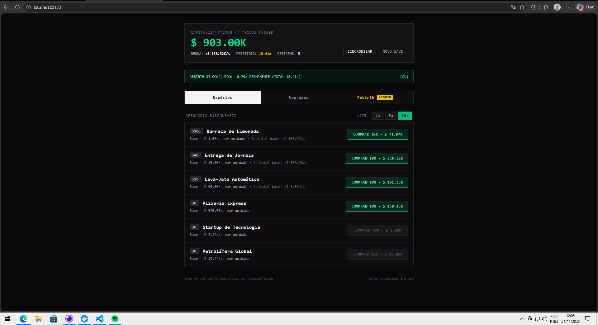

# Capitalist Tycoon — Server-Authoritative Economy Engine

Simulador econômico incremental (*idle/tycoon*) construído com foco em **engenharia back-end**: integridade transacional, cálculos financeiros de alta precisão, progresso offline sem *cron jobs* e proteção contra *race conditions*.



## Decisões de Arquitetura

* **Arquitetura Server-Authoritative:** o cliente apenas envia intenções de compra ou reset; toda validação de saldo, desconto e cálculo de renda acontece na API e no PostgreSQL. O front-end usa `requestAnimationFrame` somente para interpolação visual suave (60 FPS) sincronizada com o último estado confirmado pelo servidor.
* **Ganhos Offline via Lazy Evaluation:** em vez de rodar loops ou *cron jobs* atualizando saldos no banco a cada segundo, a API persiste apenas `balance`, `incomePerSecond` e `lastSyncedAt`. A cada interação, o rendimento acumulado é calculado sob demanda via diferença de timestamps (`agora - lastSyncedAt`).
* **Transações ACID + Row-Level Locking:** todas as operações críticas (compra de negócios em lote, compra de upgrades e *Rebirth*) rodam dentro de `prisma.$transaction` com `SELECT ... FOR UPDATE` na linha do jogador, bloqueando gasto duplo, compra duplicada (`HTTP 409`) e multiplicação indevida de prestígio sob requisições simultâneas.
* **Precisão Financeira e Escala O(1):** valores monetários utilizam `@db.Decimal(38, 2)` no PostgreSQL e `Prisma.Decimal` no back-end (arredondando ganhos com `ROUND_DOWN` e custos com `ROUND_UP`). Compras em lote (`1x`, `5x`, `10x`) são calculadas em tempo constante $O(1)$ pela fórmula fechada de progressão geométrica.
* **Sessão Anônima Persistida (Zero Atrito):** ao abrir a aplicação, a API gera um `sessionToken` criptográfico de 256 bits (`crypto.randomBytes(32)`) e persiste o save no PostgreSQL, dispensando tela de cadastro para testar o projeto sem expor o `id` interno do jogador.
* **Auditoria de Prestígio:** cada *Rebirth* zera negócios e upgrades do ciclo de forma atômica e grava um registro imutável na tabela `rebirth_histories`.

## Stack Tecnológica

| Camada | Tecnologias |
|---|---|
| **Back-end (`tycoon-api`)** | Node.js, TypeScript, Express, Prisma ORM, PostgreSQL 16, Docker Compose |
| **Testes Automatizados** | Vitest (testes unitários de regras financeiras + testes de integração/concorrência) |
| **Front-end (`tycoon-web`)** | React, TypeScript, Vite, Tailwind CSS v4, Axios |

## Endpoints da API

| Método | Rota | Autenticação | Descrição |
|---|---|---|---|
| `GET` | `/health` | Pública | Verifica status da API |
| `POST` | `/game/session` | Opcional (`Bearer`) | Cria novo save automático ou retoma save existente |
| `GET` | `/game/state` | `Bearer <token>` | Retorna estado completo com ganhos offline calculados |
| `POST` | `/game/businesses/buy` | `Bearer <token>` | Compra `1`, `5` ou `10` unidades de um negócio |
| `POST` | `/game/upgrades/buy` | `Bearer <token>` | Compra upgrade específico ou global (bloqueia duplicidade com `409`) |
| `POST` | `/game/rebirth` | `Bearer <token>` | Executa reset atômico, aplica multiplicador permanente e grava auditoria |

## Como Rodar Localmente

### Pré-requisitos
* Node.js 18+
* Docker e Docker Compose

### 1. Subir banco, migrations, seed e API (`tycoon-api`)

```bash
cd tycoon-api
cp .env.example .env
npm install
docker compose up -d
npx prisma migrate dev
npx prisma db seed
npm run dev